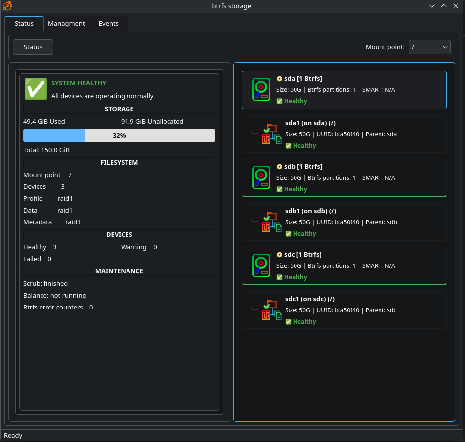
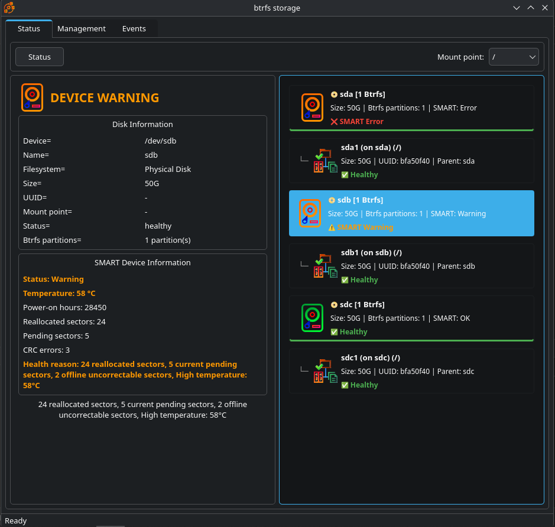
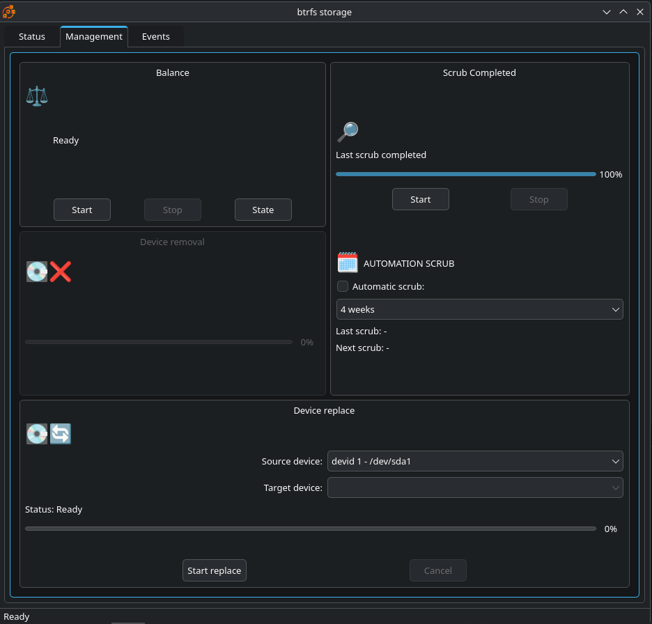
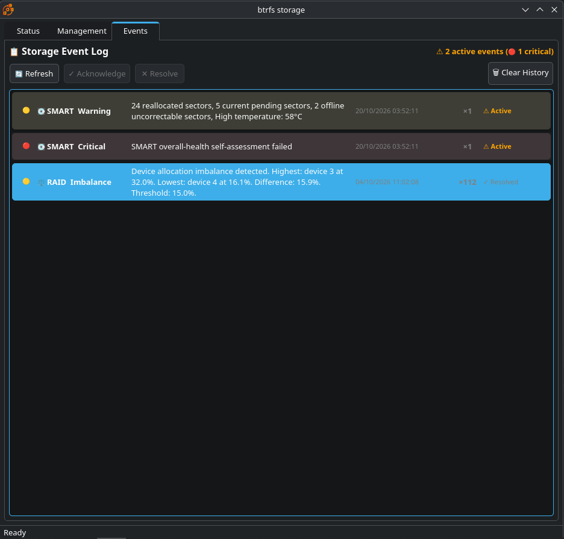

# Storage Monitor

**Storage Monitor** is a Linux desktop application for monitoring storage
devices and managing Btrfs filesystems through a Qt 6 graphical interface.

It combines Btrfs filesystem information, SMART device health monitoring,
maintenance operations and event tracking in a single application.



## Features

### Btrfs monitoring

- Filesystem overview and health status
- Device and partition visualization
- Data and metadata allocation profiles
- RAID profile information
- Missing and unhealthy device detection
- Filesystem event monitoring

### SMART monitoring

- Physical disk health status
- Temperature
- Power-on hours
- Reallocated sectors
- Pending sectors
- CRC errors
- Health reason and diagnostic information
- SMART warning and critical event generation

### Btrfs management

- Manual balance
- Scrub start, stop and progress monitoring
- Automatic scrub scheduling
- Add device
- Remove device with progress monitoring
- Replace device with progress monitoring
- Operations continue independently of the graphical application

### Events

- Btrfs and SMART event history
- Warning and critical severity levels
- Event counters
- Acknowledge / resolve workflow
- Persistent event storage

## Screenshots

### Device health and SMART information



The device view combines filesystem membership with SMART health information.
Physical disks can be inspected individually while the device list provides an
immediate overview of healthy, warning and critical states.

### Btrfs management



Maintenance and device-management operations are executed by the privileged
backend service rather than by the graphical application itself.

### Event monitoring



Storage Monitor keeps track of SMART and Btrfs events and distinguishes active,
acknowledged and resolved conditions.

## Architecture

Storage Monitor consists of two separate components:

- **`storage-monitor-agent`**  
  A system daemon responsible for monitoring, persistent state and privileged
  storage operations.

- **`btrfs-storage`**  
  A Qt 6 desktop application used to display storage information and request
  management operations.

The graphical application does **not** need to run as root.

Communication between the GUI and the daemon uses the system D-Bus.
Privileged operations are protected by Polkit authorization.

Monitoring information and operation state are persisted in an SQLite database
located under:

```text
/var/lib/storage-monitor-agent/
```

This separation allows long-running operations such as scrub, balance, device
removal and device replacement to continue even if the graphical application
is closed or restarted.

## Requirements

Storage Monitor is intended for Linux systems using:

- Qt 6
- CMake 3.16 or newer (required when building from source)
- Btrfs userspace tools (`btrfs-progs`)
- `smartmontools`
- systemd
- D-Bus
- Polkit
- SQLite support for Qt

A working Btrfs filesystem is required for Btrfs management functionality.

SMART availability depends on the capabilities of the underlying storage
device and controller.

## Installation

### Arch Linux / CachyOS

A prebuilt Arch Linux package is available from the
[GitHub Releases](https://github.com/Brigio/storagemonitor/releases) page.

For the current release, download:

`storage-monitor-1.0.0-1-x86_64.pkg.tar.zst`

Install it with:

```bash
sudo pacman -U ./storage-monitor-1.0.0-1-x86_64.pkg.tar.zst
```

Then enable and start the monitoring daemon:

```bash
sudo systemctl enable --now storage-monitor-agent
```

Launch the graphical application with:

```bash
btrfs-storage
```

or from the desktop application menu.

Optional: install `msmtp` if you want to use email notifications.

The prebuilt package currently targets `x86_64` Arch Linux compatible systems.

### Build from source

On Arch Linux / CachyOS, the required build tools can be installed with:

```bash
sudo pacman -S --needed base-devel cmake ninja qt6-base btrfs-progs smartmontools polkit
```

Clone the repository:

```bash
git clone https://github.com/Brigio/storagemonitor.git
cd storagemonitor
```

Configure and build both the daemon and graphical application:

```bash
cmake -S . -B build -DCMAKE_BUILD_TYPE=Release
cmake --build build -j$(nproc)
```

Install the project system-wide:

```bash
sudo cmake --install build --prefix /usr
```

Reload systemd and enable the monitoring daemon:

```bash
sudo systemctl daemon-reload
sudo systemctl enable --now storage-monitor-agent
```

Check that the daemon is running:

```bash
systemctl status storage-monitor-agent
```

Launch the graphical application with:

```bash
btrfs-storage
```

## Security model

The graphical application runs as the normal desktop user.

Operations requiring administrative privileges are sent to
`storage-monitor-agent` over the system D-Bus and are authorized through
Polkit.

This avoids running the entire graphical application with root privileges.

## Important notice

Storage management operations such as balance, device removal and device
replacement can modify filesystem state.

Always maintain current backups of important data before performing storage
maintenance or changing the device layout of a Btrfs filesystem.

## Project status

The project delivers a core feature set for monitoring and Btrfs management.
Development is active, and additional functionality will be introduced in
future releases.

## License

Storage Monitor is free software licensed under the
**GNU General Public License v3.0 or later** (`GPL-3.0-or-later`).

See the `LICENSE` file included with the source code for details.
